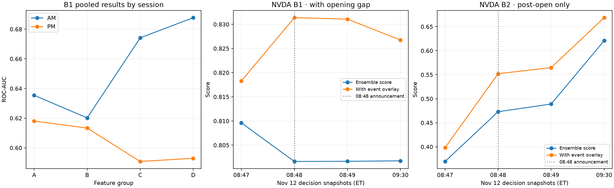

# V3 财经新闻与半日波动预警实验

**三标的联合早盘中，V3 完整集成模型的 AUC 从量价基准的 0.635 提高至 0.688，配对增量为 +0.052，95% 区间为 [+0.003, +0.100]。** 该结果使用保守时间戳，覆盖 723 个样本外早盘、72 个异常。主模型的 AUC 和 PR-AUC 仍低于方案预期的 0.70 和 0.28。NVDA 单标的、午盘和 Granger 检验也未呈现同等强度的改善。[消融结果](results/v3/ablation.csv) · [配对区间](results/v3/paired_auc.csv)

## 分训与特征消融

| 保守时间戳，含跳空 B1 | 量价 AUC | 去噪情感 C AUC | 完整 D AUC | 完整 D PR-AUC |
|---|---:|---:|---:|---:|
| 三标的联合 AM，0.7 L2 + 0.3 单调 LightGBM | 0.635 | 0.674 | 0.688 | 0.263 |
| 三标的联合 AM，L2 | 0.633 | 0.670 | 0.686 | 0.255 |
| 三标的联合 AM，Ridge 连续目标 | 0.622 | 0.646 | 0.661 | 0.256 |
| NVDA AM，0.7 L2 + 0.3 单调 LightGBM | 0.712 | 0.694 | 0.685 | 0.282 |

完整集成模型在联合早盘发出 113 次常规警报，命中 25 次，召回率 34.7%，警报命中率 22.1%。在每月固定检查最高 15% 分数的排序诊断中，召回率为 30.6%；最高 5% 的命中率是异常率的 3.77 倍。两类简报规则合计标记 40 个早盘，其中 14 个实际异常。

**独立训练有利于定位差异，效果取决于标的。** 在相同 V2 情感特征和 L2 下，只做分训使 NVDA 早盘 AUC 从 0.747 降至 0.704，联合早盘 AUC 从 0.690 降至 0.675，联合 PR-AUC 从 0.243 升至 0.254。V3 联合早盘完整集成比同管线情感组高 0.014 AUC，配对区间为 [−0.0001, +0.030]；NVDA 单标的的完整组仍低于情感组。V3 联合午盘完整集成 AUC 为 0.593，仅保留实质性中高冲击报道时为 0.602，PR-AUC 从 0.213 升至 0.232。结果仍支持把午盘作为独立对照。

**连续目标有局部优势。** 剥离隔夜跳空的联合 B2 早盘有 723 个样本外观察、74 个异常。完整 Ridge 的 AUC 和 PR-AUC 为 0.642、0.213，高于同口径完整集成的 0.622、0.201；在含跳空 B1 下，完整 Ridge 低于集成。连续训练表现随目标定义变化。

## 时间戳敏感性与先导检验

缓存含 7,845 条标的—文本记录，其中 5,075 条标为市场噪音，最终符合 V3 实质新闻规则的有 2,755 条。实际有 4,076 条可用时间迟于首发，其中 2,259 条超过一小时，占全库 28.8%。有界方案将 2,252 条回退至首发时点，因标题包含复盘词剔除 7 条。[审计明细](results/v3/audit.json)

联合早盘完整集成在有界口径下的 AUC 和 PR-AUC 为 **0.699、0.270**，对各自量价基准的 AUC 增量为 +0.064，区间 [+0.023, +0.109]。有界口径中 AUC 最高的是单调 LightGBM，得 0.702，PR-AUC 为 0.246。缺少原始首发标题版本，因此 0.702 属于时间戳敏感性结果。

36 项联合面板 AM Granger 检验均未达到 BH 校正后的 5% 显著水平。最低 q 值为 **0.0745**，来自保守时点下纯盘中 B2 的累积冲击及情绪分歧结果之一；有界口径最低 q 为 0.367。回退首发时点没有增强这一统计证据。[Granger 检验明细](results/v3/pooled_granger.csv)

## 11 月 12 日公告回放

| 美东截断时点 | B1 原始集成分 | B1 规则叠加后 | B2 原始集成分 | B2 规则叠加后 |
|---|---:|---:|---:|---:|
| 08:47 | 0.810 | 0.818 | 0.369 | 0.398 |
| 08:48，正式公告到达 | 0.802 | 0.831 | 0.473 | 0.552 |
| 08:49 | 0.802 | 0.831 | 0.489 | 0.565 |
| 09:30，常规开盘 | 0.802 | 0.827 | 0.621 | 0.669 |

08:47 前已有一级信源三级报道。缓存中的正式公告于 08:48 进入窗口，并作为独立的一级事件触发简报。公告后一分钟，含跳空 B1 的原始分数略降，规则叠加后的分数从 0.818 升至 0.831；纯盘中 B2 的原始分数从 0.369 升至 0.489。去掉跳空后，可以直接检验开盘前信息对随后常规早盘目标的得分影响。临近极值的 B1 L2 分数提示该快照存在外推饱和，叠加分属于预警展示规则。[事件回放](results/v3/event_replay.csv) · [逐时点事件简报](results/v3/event_briefs.csv) · [定时简报](results/v3/scheduled_briefs.csv)



本轮完成方案中的两批离线实验。三只股票沿用冻结语料，MSFT 覆盖限制仍适用。运行前后的 API 用量账本哈希一致，新增调用及费用均为零。


## 研究口径与复现

- **样本与切分。** 沿用 NVDA、MSFT、TSLA 和原研究的 469 个共同交易日。AM、PM 分别训练、估计分位线并评估。B1 沿用含跳空的早盘标签，B2 单独检验剥离隔夜跳空后的早盘。每折先以较早训练数据拟合，用训练期后 35% 的前向验证分数估计 85% 预警线与 95% 简报线，再用该折完整训练集拟合。L2 的混训与分训对照使用相同 V2 特征。联合样本按日期一起切分和重抽，95% 区间使用 1,000 次五交易日分块配对抽样。
- **去噪与消融。** A 使用量价和 QQQ，B 增加金融词典，C 增加去噪后的情感、热度和噪音占比，D 再加入加权累积冲击、最低情感分和一级信源三级事件标志。过滤掉 `market_noise` 或冲击等级低于 1 的报道后，以置信度、信源权重和时间衰减的乘积计算加权情感。累积冲击保留绝对时效，并用 `log1p` 转换。一级、二级、三级源权重分别为 1.0、0.3、0.1。额外对照包括去噪后等信源权重，以及 PM 仅使用冲击等级至少为 2 的实质新闻。
- **模型与决策线。** 比较 L2、ElasticNet、单调 LightGBM 和 0.7 L2 + 0.3 单调 LightGBM 集成。树对累积冲击、新闻热度和一级三级事件三个特征施加非递减约束。叶内分数仍可持平。另以截尾到 [−2, 6] 的真实波动 Z 值训练 Ridge 和 Huber LightGBM，将预测 Z 值直接用于二值异常的排序评估。分类器使用未校准分数。统计简报按 95% 分位线或 3.5 倍训练异常率触发，回归分数只应用分位线。每月 Recall@Top15% 与 Lift@Top5% 是事后检验的固定预算排序指标。
- **时间戳与 Granger。** 主实验使用报道可用时点 `max(published, modified)`。有界回退保留一小时内的修改时间；超过一小时且标题命中收盘复盘词的报道剔除，其余回退首发时间。已修订标题缺少首发版本，词表只能筛查部分前视信息，因此回退结果用作敏感性对照。联合面板 Granger 使用股票固定效应与日期聚类检验，测试新闻热度、情绪分歧和累积冲击的 1–3 阶滞后，对全部 V3 检验统一做 BH 校正。
- **事件回放。** 统计路径与一级信源三级事件路径分别记录。在盘前快照中，展示分在集成分数之上叠加最近一级三级事件的冲击，取剩余分数空间的 15%，按一小时半衰期递减。展示分用于解释事件规则，模型消融与 AUC 始终使用原始模型分数。简报复用已缓存的事件理由和本地文本模板。规则以缓存中的到达时间重放，实际采集、评分和推送耗时未测。11 月案例参与过前两轮研究，本轮仍属回顾性验证。

从项目根目录执行以下命令。输入为上一轮冻结语料、行情和对照结果。输出写入 `results/v3/`。

```powershell
.\.venv\Scripts\python run_experiment_pipeline.py --study v3
```


