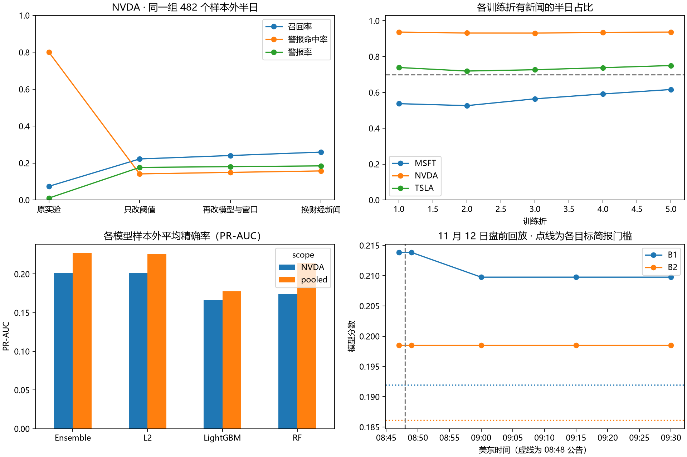

# NVDA 异常波动预警改进研究

**财经语料覆盖和异常召回均有改善，但未观察到稳定的语义排序增益。** NVDA 的新半日模型在相同的 482 次样本外预测中，发出 89 次警报、命中 14 个异常；原模型发出 5 次、命中 4 个。11 月 9 日和 12 日均触发新版高风险简报。11 月 12 日公告前一分钟，模型已处于高风险区间，公告后一分钟分数持平。

## 同一批异常能找回多少

下表固定 NVDA、含跳空半日目标 B1、54 个样本外异常和 LightGBM。警报率是全部时段中发出警报的比例，命中率是警报中真正异常的比例。

| 实验阶段 | ROC-AUC | PR-AUC | 警报数 | 命中异常 | 召回率 | 命中率 |
|---|---:|---:|---:|---:|---:|---:|
| 原模型，固定 0.5 阈值 | 0.610 | 0.205 | 5 | 4 | 7.4% | 80.0% |
| 原预测分数，只改训练期分位阈值 | 0.610 | 0.205 | 85 | 12 | 22.2% | 14.1% |
| 再改窗口、量价特征与模型，仍用旧语料 | 0.595 | 0.142 | 87 | 13 | 24.1% | 14.9% |
| 再换财经语料与评分锚点 | 0.582 | 0.166 | 89 | 14 | 25.9% | 15.7% |

只改变决策阈值就多识别出 8 个异常，同时多发出 80 次警报。换财经语料后，相对同架构旧语料，PR-AUC 从 0.142 升至 0.166，ROC-AUC 从 0.595 降至 0.582。主模型的召回率低于方案预期的 35%–55%。若业务严格限制每月仅检查分数最高的 15%，事后月内排序的召回率为 20.4%；排名最高 5% 的命中率是样本异常率的 1.70 倍。[同样本逐阶段对照](results/improved/before_after.csv) · [新旧模型配对区间](results/improved/revised_vs_original.csv)

**类别加权与校准。** 加权 LightGBM 加保序校准的对照达到 40.7% 召回率，发出 136 次警报，占 482 个时段的 28.2%，命中率 16.2%。加权模型 Brier 从未校准的 0.211 降至保序校准后的 0.099；未加权主模型为 0.098。F2 最优线在未加权主模型上取得 100% 召回率，但 F1 只有 0.202，说明仅报告召回会掩盖警报负担。这些是预先列出的备选方案在测试集上的结果。[权重、校准及阈值对照](results/improved/finance_ablation.csv)

## 补齐了哪些信息

从 6 个媒体来源、SEC 和指定事件记录取得 **7,845 条标的—文本记录**，涉及 7,735 个独立评分输入。NVDA 获得 1,750 条 CNBC 记录、1,641 条 24/7 Wall St. 记录、32 条含实质披露的 SEC 文件，另有其他媒体与事件记录。对 4,076 条存在后续修改的标的—报道记录，按较晚时刻入窗。用量没有通过重复采样负面新闻来调整。

| 标的 | 文本记录 | 半日窗口覆盖率 | 全语料负面占比 | 五折训练期实质事件占比最低值 | 方案三项门槛 |
|---|---:|---:|---:|---:|---|
| NVDA | 4,587 | 93.8% | 16.1% | 19.6% | 达到 |
| MSFT | 1,348 | 62.4% | 12.0% | 16.5% | 覆盖、负面占比不足 |
| TSLA | 1,910 | 75.2% | 24.2% | 19.1% | 达到 |

实质事件要求冲击等级至少为 2 且类别非市场噪音。近期整库门槛分别为覆盖率 70%、负面占比 15%、训练期实质事件占比 10%。逐折复核揭示了整库平均值隐藏的变化：NVDA 各训练折的负面占比仅 11.5%–13.1%，11 月高冲击窗口提高了整库负面比例。TSLA 五折均达标，MSFT 五折均未同时达标。三标的联合结果据此作探索性解释。[整库验收](results/improved/corpus_acceptance.csv) · [训练期逐折验收](results/improved/finance_quality.csv) · [文本与评分明细](results/improved/finance_news_index.csv.gz)

## 语义信息和市场基准各贡献多少

NVDA 半日 LightGBM 的 A/B/C/D 四组 AUC 分别为 0.590、0.578、0.583、0.582。完整模型 D 相对量价与市场基准 A 的增量为 −0.008，配对 95% 区间为 [−0.047, +0.027]；相对基础情感 C 为 −0.001，区间为 [−0.019, +0.018]。软投票集成 E 的 AUC 为 0.579，PR-AUC 为 0.202，高于 D 的 0.166。同期跨日 D 的 AUC 从首轮 0.445 提高至 0.550。保留旧历史语料的 2019–2023 年跨日对照中，改进后 D 的 AUC 为 0.629，原值为 0.585。[消融配对区间](results/improved/finance_paired_auc.csv) · [历史跨日对照](results/improved/historical_control_ablation.csv)

| 完整 LightGBM | 样本外观察 | 异常数 | AUC | PR-AUC | 召回率 |
|---|---:|---:|---:|---:|---:|
| NVDA，B1 全部半日 | 482 | 54 | 0.582 | 0.166 | 25.9% |
| NVDA，B1 仅早盘 | 241 | 28 | 0.628 | 0.241 | 35.7% |
| NVDA，B2 仅早盘，完全移除跳空 | 241 | 30 | 0.577 | 0.179 | 30.0% |
| 三标的联合，B1 全部半日 | 1,446 | 145 | 0.634 | 0.177 | 29.0% |
| 三标的联合，B2 全部半日 | 1,446 | 147 | 0.613 | 0.162 | 23.1% |
| 三标的联合，跨日 | 723 | 80 | 0.621 | 0.235 | 22.5% |

联合 B1 的异常数从 54 增到 145，接近方案设定的 150 个以上。D 对 A 的 AUC 增量为 +0.006，区间 [−0.015, +0.026]，比单标的区间窄但仍跨零。D 相对词典 B 增加 0.024，逐项区间 [+0.006, +0.044]；相对 C 增加 0.004，区间跨零。合并样本后识别能力有所区别，但数据没有支持 D 相对量价基准显著改善或稳定达到 0.72 的预期。[联合模型按股票分解](results/improved/pooled_by_symbol.csv)

**时序关系。** 单标的 135 项、联合面板 45 项检验在各自表内校正后均未达到 5% 显著水平。联合纯盘中早盘的一阶平均事件冲击与波动关联，原始 p = 0.0044，校正后 q = 0.114。该结果不足以认定新闻冲击具有稳定的统计先导性。[单标的检验](results/improved/finance_granger.csv) · [联合面板检验](results/improved/finance_pooled_granger.csv)

## 11 月 12 日的风险来自何时

| 美东时刻 | 截断前窗口文本数 | B1 分数 | B2 分数 | 是否达到两条模型各自的简报门槛 |
|---|---:|---:|---:|---|
| 08:47，公告前一分钟 | 32 | 0.214 | 0.198 | 是 |
| 08:49，公告后一分钟 | 34 | 0.214 | 0.198 | 是 |
| 09:30，常规早盘截断 | 43 | 0.210 | 0.198 | 是 |

B1 的当折高风险分位线为 0.192，B2 为 0.186。08:48 的公司公告被 DeepSeek 判为三级冲击、情感 −0.9，但公告前窗口已有风险信息。新增两条文本后，浅树给出的 B1 和 B2 分数均持平。时间轴支持“开盘前已处于高风险状态”，并未观察到由该公告带来的首次越线。11 月 9 日和 12 日在常规开盘均触发 B1 简报；全部 482 个样本外半日中，28 次 B1 简报有 7 次对应异常、21 次对应正常。[事件分时回放](results/improved/finance_event_replay.png) · [截断、阈值与 SHAP 明细](results/improved/finance_case_scores.csv) · [自动简报](results/improved/finance_briefs.csv)




本轮实记 877 次有用量记录的请求，新增费用估算 **0.2724 美元**，含首轮累计 **0.4843 美元**。产生 87 份 NVDA 简报，涵盖 B1、B2、跨日及事件回放中的触发时点，同一时刻的不同目标分别记录。最大 SHAP 概率重构误差约 2.1×10⁻⁸。[用量和数据快照校验值](results/improved/audit.json) · [逐文件核验](results/improved/verification.csv)

## 方法与复现

**比较设计。** 保留原版结果，以原研究的 469 个 NVDA 交易日为近期比较日历。主要终点为近期样本外半日 B1（隔夜跳空加早盘波动，午盘保持原定义）。按相同的日期、时段、标签依次比较原模型、只改预警规则、复用旧缓存的窗口与模型改造、替换财经语料和评分提示。第三步同时改变了窗口、市场特征与模型，第四步同时改变语料与评分锚点，两步各自的效果均属于组合改动。改进方案参考过首轮测试结果，因此这里的按时间留出属于回顾性复核，独立外推仍需要新的市场日期。

**可预测的时间段。** AM 文本从上一交易日 12:30 至本日 09:30，PM 从 09:30 至 12:30；指数时间衰减系数为每小时 0.25。B2 将 AM 的第一笔收益起点设在当日开盘，移除隔夜跳空，并对纯盘中波动重新计算过去 20 个同类时段的均值、标准差及异常标签。午盘在 B1 和 B2 中定义相同。跨日基准继续使用前一收盘截断。波动目标都保留已实现波动与盘中极差估计的较大值。08:49 回放使用截至该时刻的文本与上一已结束时段的市场信息；它检验信息可用性。模型按 09:30 窗口训练，提前应用于不完整窗口属于回放外推。真实系统的新闻传输延迟和评分耗时并未在当时实盘测量。

**特征与模型。** 所有消融组都加入 QQQ 的上一期收益、5 期和 20 期波动，以及 NVDA、MSFT 或 TSLA 与 QQQ 的上一期波动比。方案将市场特征称为三维，按逐项定义实际保留四列。A 为量价和市场基准，B 增加词典，C 增加基础情感及有无新闻标记，D 再加事件平均冲击、高危占比和窗口内最高冲击。E 为 D 输入下 L2 与浅层 LightGBM 的等权概率平均。LightGBM 采用 60 棵树、深度 3、最多 5 个叶节点及 L1/L2 正则。随机森林作为第三种基分类器。单股票及三股票联合模型均按日历分割，联合模型不跨股票拼接滚动历史。

**阈值与误报。** 每个外层训练集按日期分成前约 65% 与后约 35%。先在较早部分拟合，再用较晚部分产生前向验证分数、估计 85% 预警分位线、95% 简报分位线，并求 F1、F2 最优阈值。外层模型重用完整训练集拟合。简报条件为超过或等于 95% 分位线，或分数达到该折训练异常率的 3.5 倍。常规模型使用原始分数；全特征组另比较类别平衡、Platt 和保序回归（isotonic）的概率校准。校准器只看内层验证数据，Brier 在外层测试集计算。树模型产生并列分数，样本外警报率可以偏离训练期 15% 定额。

**指标读法。** PR-AUC 取平均精确率。主表的 Recall、Precision、F1 来自部署时可用的逐折 85% 分位线。另行计算的 Recall@Top15% 和 Lift@Top5% 按每个样本外月份的分数排名，预算向下取整；它们描述事后固定工作量下的排序能力，不能充当在线阈值。消融置信区间按五个交易日为块做 500 次配对重抽，联合面板将同日的不同股票共同抽取。区间条件于本次训练结果，未经多项消融校正。

**语料与披露。** 主语料使用有标的关联的财经标题、公司正式消息及 SEC 备案，开发者博客保留作第一阶段对照。财经站点按公司名检索，并按标题中的公司名或股票代码筛选；CNBC 亦纳入明确涉及 Azure 的微软报道。可修改的报道按首次发布与最后修改两者的较晚时刻进入窗口，SEC 取接受时间。8-K 提取 Item 说明及正文片段，10-Q/K 提取带期间的可识别财务报表项目。AP 与公司治理案例沿用方案指定的历史事件记录。系统按标的及提示词区分评分缓存，采用 0–3 级金融冲击锚点，评分时关闭搜索。新闻覆盖、负面占比、训练期实质事件占比按方案独立验收，缺失报道不计作中性文章。[SEC 原始披露](https://www.sec.gov/edgar/search/) · [CNBC 发布档案](https://www.cnbc.com/site-map/) · [逐条报道、可用时间及评分](results/improved/finance_news_index.csv.gz)

**时序检验。** 单标的按 AM、PM 或日度分别做 1–3 阶 Granger 检验。联合面板在各股票内部构造滞后，加入股票固定效应，并按交易日聚类估计标准误，对各阶文本滞后系数做联合 F 检验。各输出表内应用 Benjamini–Hochberg 多重检验校正。结果描述历史先导关系。

**复现。** 在项目根目录执行以下命令。第一条使用冻结数据和缓存重算改进实验，包括原语料历史跨日对照。第二条核对预测唯一性、切分先后、新闻计数、双目标、简报规则和 SHAP 概率重构，并生成对照表与看板。补评分时使用 `--mode deepseek`；估价使用 `--dry-run`。单独复现旧研究可使用 `--study original --mode demo`。

```powershell
.\.venv\Scripts\python run_experiment_pipeline.py --study improved --mode demo
.\.venv\Scripts\python revision_audit.py
```


